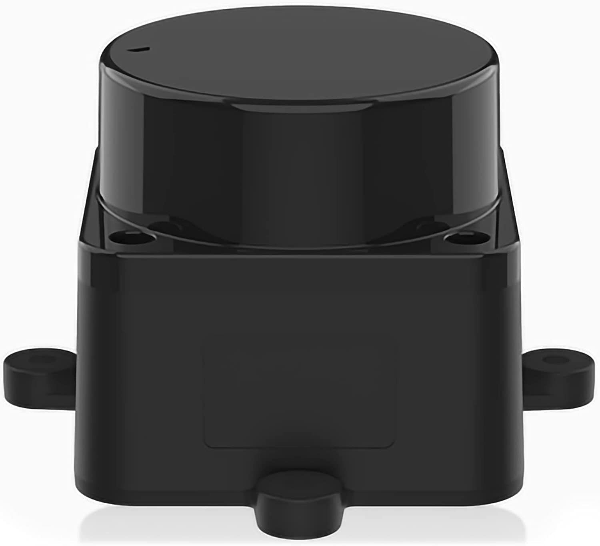
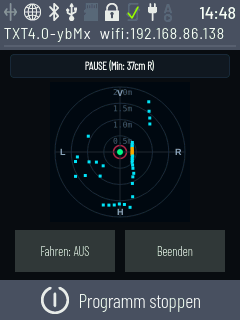
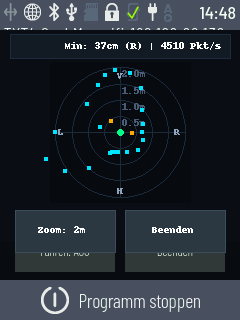
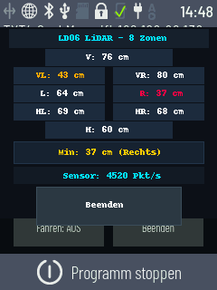

# LD06 LiDAR-Treiber & Apps für fischertechnik TXT 4.0

[-blue.svg)](https://www.fischertechnik.de)
[](https://www.yoctoproject.org/)
[](https://www.python.org/)
[](https://www.qt.io/)
[](LICENSE)

Python-Treiber und vier Touchscreen-Apps für den **LDROBOT LD06 360°-LiDAR** am **fischertechnik TXT 4.0 Controller** – inklusive einer autonomen 8-Wege-Ausweichsteuerung für Omniwheel- und Mecanum-Roboter.

> **Älterer TXT Controller?** Für den klassischen **ROBOTICS TXT** mit Community-Firmware gibt es ein eigenes Repository: [FT-txt-ld06-lidar](https://github.com/Zwergnase94/FT-txt-ld06-lidar).

---

## Hardware & Screenshots

| Sensor: LD06 LiDAR | `lidar_omni` | `lidar_radar` | `lidar_8zones` |
|:---:|:---:|:---:|:---:|
|  |  |  |  |
| *LD06 mit USB-Adapter* | *Omniwheel-Ausweichsteuerung* | *360°-Radar mit Zoom* | *8-Sektoren-Dashboard* |

### Eckdaten des Sensors (LDROBOT LD06)
* **Messprinzip:** Direct Time-of-Flight (DToF), 360°-Rundumscan
* **Abtastrate:** ca. 4.500 Punkte/s bei 10–13 Hz Drehzahl
* **Messbereich:** 0,02 m bis 12 m (Winkelauflösung ca. 0,8°–1,0°)
* **Anschluss:** UART (230.400 Baud) per CP2102-USB-Adapter direkt an der USB-Buchse des TXT 4.0 (`/dev/ttyUSB0`). Der passende Kernel-Treiber (`cp210x`) ist ab Firmware 5.0.1 bereits integriert.

Details zur Steckerbelegung stehen unter [`docs/pinout_and_hardware.md`](docs/pinout_and_hardware.md).

---

## Enthaltene Apps

Alle vier Apps liegen als fertige Workspaces für `/opt/ft/workspaces/` vor und lassen sich direkt über das Touchscreen-Menü des TXT 4.0 starten.

### 1. `lidar_omni` – 8-Wege-Ausweichsteuerung (Omniwheels)
Reaktive Hindernisvermeidung für ein 4-motorisches Omniwheel-/Mecanum-Fahrwerk (M1–M4):
* **Live-Radar:** Zeigt Punktwolke, eine rote 20-cm-Warnzone und die aktuelle Ausweichrichtung als Pfeil.
* **Direktes Ausweichen:** Unterschreitet ein Objekt in einem der 8 Sektoren **20 cm**, fährt der Roboter ohne Drehung in die Gegenrichtung – sofern dort mindestens **22 cm** frei sind (sonst Sicherheitsstopp `BLOCKIERT`).
* **Hysterese:** Das Manöver endet erst bei **> 25 cm** Abstand, um Hin- und Herpendeln zu vermeiden.
* **Sicherer Start:** Startet standardmäßig mit deaktivierten Motoren (`Fahren: AUS`), umschaltbar per Touch-Button.

Die genaue Motorbelegung und Drehrichtungs-Tabelle ist in [`docs/OMNIWHEEL_AVOIDANCE.md`](docs/OMNIWHEEL_AVOIDANCE.md) dokumentiert.

### 2. `lidar_radar` – 360°-Radar mit Zoom
* Rundumsicht auf dem internen Display mit Distanzringen und Anzeige des nächsten Hindernisses (z. B. `Min: 42 cm (VL)`).
* Zoomstufen per Touch umschaltbar: **1 m, 2 m, 4 m und 8 m**.

### 3. `lidar_8zones` – 8-Sektoren-Dashboard
* Übersichtliche Balkenanzeige für alle 8 Richtungen (Vorne, VR, R, HR, Hinten, HL, L, VL) mit Farbumschlag (Grün > 60 cm, Gelb 30–60 cm, Rot < 30 cm).

### 4. `lidar_web` – Live-Ansicht im Browser
* Startet einen lokalen HTTP-Server auf dem TXT 4.0 (Port `8088`) und zeigt das 360°-Radar live im Browser auf PC, Tablet oder Smartphone an (`http://<TXT_IP>:8088`).

---

## Technische Besonderheiten & Fixes am TXT 4.0

Ausführliche Hintergründe sind in [`docs/TXT40_INTEGRATION_AND_INSIGHTS.md`](docs/TXT40_INTEGRATION_AND_INSIGHTS.md) beschrieben.

* **Nutzbarer Display-Bereich (240 × 230 Pixel):** Das physische Display hat 240 × 320 Pixel, allerdings reserviert `qtmenu` Ränder für Systemleisten. Alle Steuerelemente sind daher auf `y ≤ 225` ausgelegt, damit nichts abgeschnitten wird.
* **Fix gegen eingefrorene Anzeige (`ftgui` Race Condition):** Im originalen `ftgui.py` kann die schnelle lokale MQTT-Antwort (`127.0.0.1`) `setter_request` dauerhaft blockieren, sodass das Display nach wenigen Sekunden einfriert. [`lib/display.py`](apps/lidar_omni/lib/display.py) behebt das per Lock, 150-ms-Watchdog und gebündelten Attribut-Updates (`set_attrs`).
* **Filterung von 6-cm-Geisterwerten:** Schwache Reflexionen an fernen Kanten erzeugen beim LD06 vereinzelt Rauschpunkte mit niedriger Signalstärke (`conf` ~20–25), die ungefiltert als Hindernis bei ca. 6 cm erscheinen. [`driver/ld06.py`](driver/ld06.py) prüft jedes Paket per CRC-8 und verwirft Punkte mit `conf < 100` oder `dist < 30 mm`.

---

## Installation & Verwendung

### App auf den TXT 4.0 kopieren
Gewünschten App-Ordner per `scp` in das Workspace-Verzeichnis des Controllers übertragen:

```bash
# Beispiel: lidar_omni übertragen
scp -r apps/lidar_omni ft@<TXT_IP>:/opt/ft/workspaces/
```

Die App taucht danach direkt im Menü des TXT 4.0 auf.

### Treiber in eigenen Python-Skripten nutzen
[`driver/ld06.py`](driver/ld06.py) benötigt lediglich `pyserial` und kann eigenständig eingebunden werden:

```python
import time
from ld06 import LD06

lidar = LD06("/dev/ttyUSB0")

while True:
    for angle_deg, dist_mm, conf in lidar.read_points():
        print(f"{angle_deg:5.1f}° | {dist_mm / 10.0:5.1f} cm (conf={conf})")
    time.sleep(0.02)
```

---

## Verzeichnisstruktur

```text
FT-txt-4.0-ld06-lidar/
├── driver/
│   └── ld06.py                            # LD06-Treiber (CRC-8 & Signalstärken-Filter)
├── apps/
│   ├── lidar_omni/                        # 8-Wege Omniwheel-Ausweichsteuerung
│   │   ├── lidar_omni.py
│   │   ├── ld06.py
│   │   └── lib/ (display.py, display.qml, omni_drive.py)
│   ├── lidar_radar/                       # 360°-Radar mit Zoom
│   ├── lidar_8zones/                      # 8-Sektoren-Balkenanzeige
│   └── lidar_web/                         # Browser-Ansicht (HTTP Port 8088)
└── docs/
    ├── TXT40_INTEGRATION_AND_INSIGHTS.md  # Details zu Viewport, ftgui-Fix & Sensorfilter
    ├── OMNIWHEEL_AVOIDANCE.md             # Motorbelegung & 8-Wege-Kinematik
    ├── pinout_and_hardware.md             # Pinbelegung & USB-Anschluss am TXT 4.0
    └── screenshots/
```

---

## Lizenz & Autor

* **Autor:** Manuel Neumann ([Zwergnase94](https://github.com/Zwergnase94))
* **Lizenz:** [MIT License](LICENSE)
