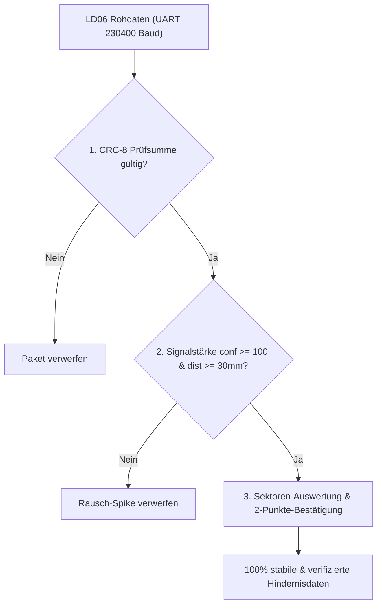

# fischertechnik TXT 4.0 LiDAR Integration & Engineering Insights

Dieses Dokument fasst die technischen Erkenntnisse, Architektur-Besonderheiten und Fehlerbehebungen zusammen, die bei der Integration des **LD06 DToF LiDAR-Sensors** auf dem **fischertechnik TXT 4.0 Controller** (Firmware 5.0.1+, Linux Kernel 5.10 Yocto, Python 3.12) entwickelt und gelöst wurden.

---

## 1. Systemarchitektur des TXT 4.0

| Komponente | Spezifikation |
|---|---|
| **Controller** | fischertechnik TXT 4.0 (Model 179423) |
| **Betriebssystem** | Yocto Linux (Kernel 5.10.188-ktn, ARM Cortex-A7) |
| **Python** | Python 3.12.x |
| **Display-System** | Capacitive Touchscreen (physisch $240 \times 320$ Pixel) |
| **GUI-Framework** | `qtmenu` mit QtQuick 2.2 / QML |
| **IPC & GUI-Bridge** | Mosquitto MQTT Broker (`127.0.0.1:2883`) via `ftgui.py` |
| **Sensor** | LD06 DToF LiDAR (230.400 Baud, native CP2102-Schnittstelle `/dev/ttyUSB0`) |

---

## 2. Display-Geometrie & Koordinatenfenster ($240 \times 230$)

### Die Falle:
Das physische Display des TXT 4.0 hat eine Auflösung von $240 \times 320$ Pixeln im Hochformat.
Das Host-System `qtmenu` reserviert jedoch die obere Statusleiste (Akku, WLAN, Titel) und die untere Systemnavigationsleiste.

### Die Lösung:
Für Benutzer-Apps (`TXTWindow` in QML) steht exakt ein Viewport von **$240 \times 230$ Pixeln** zur Verfügung:
- $X \in [0, 240]$
- $Y \in [0, 230]$

Elemente oder Schaltflächen, die bei $y \ge 230$ platziert werden (wie in herkömmlichen fischertechnik-Beispielen mit $y=235..270$), liegen **vollständig außerhalb des sichtbaren Fensters** und werden abgeschnitten.

**Empfohlenes Layout:**
- $Y \in [4, 28]$: Informationsleiste / Statusanzeige ($h=24$)
- $Y \in [32, 172]$: Radaranzeige / Canvas ($140 \times 140$, zentriert bei $x=50$)
- $Y \in [180, 222]$: Touch-Buttons ($h=42$), z. B. Modus-Umschalter und Beenden-Button.

---

## 3. Analyse & Behebung des `ftgui`-MQTT Deadlocks (Screen Freeze)

### Das Fehlersymptom:
Nach einigen Sekunden (ca. 5–15 Sekunden) fror die Bildschirmanzeige auf dem TXT 4.0 ein und aktualisierte sich nicht mehr, während das Python-Programm im Hintergrund völlig normal weiterlief. Der RAM-Speicher war dabei völlig unkritisch (> 270 MB frei).

### Ursachenanalyse im Quellcode (`ftgui.py`):
In `/usr/lib/python3.12/site-packages/ftgui.py` steuert die Klasse `fttxt2_gui_connector` die Kommunikation zwischen Python und der QtQuick-Oberfläche über MQTT:

```python
def run_queue(self, forced=False):
    self.setter_lock.acquire()
    if bool(self.setter_queue):
        if self.setter_request == None or forced:
            q = self.setter_queue
            self.setter_queue = dict()
            self.setter_lock.release()
            # Publish erfolgt NACH Lock-Release:
            self.setter_request = self.client.publish(self.topic_notify, ..., qos=2)
            return
    self.setter_lock.release()

def on_publish(self, client, userdata, mid):
    if self.setter_request != None and mid == self.setter_request.mid:
        self.setter_request = None
    self.run_queue()
```

**Die Race Condition:**
1. Über das lokale Loopback-Interface (`127.0.0.1`) ist die Netzwerklatenz kleiner als $0,1\text{ ms}$.
2. Mosquitto sendet die Bestätigung (`PUBCOMP`) sofort zurück.
3. Der Paho-MQTT Hintergrundthread empfängt die Bestätigung und ruft `on_publish()` auf, **noch bevor** der Python-Hauptthread die Zuweisung `self.setter_request = ...` abgeschlossen hat!
4. In `on_publish` ist `self.setter_request` daher noch `None` – die Bedingung `mid == self.setter_request.mid` schlägt fehl.
5. Anschließend vollendet der Hauptthread die Zuweisung: `self.setter_request` ist nun dauerhaft belegt und wird nie wieder gelöscht!
6. Alle folgenden Aufrufe von `set_attr()` werden durch `if self.setter_request == None` blockiert – die Anzeige friert für immer ein.

### Die Lösung (`lib/display.py` Monkey-Patch):
1. **Atomare Verriegelung:** `client.publish()` und die Zuweisung von `setter_request` erfolgen geschützt unter `setter_lock`.
2. **Watchdog-Fallback:** Sollte eine Bestätigung dennoch länger als $150\text{ ms}$ ausbleiben oder `setter_request.is_published()` bereits `True` sein, wird der Request automatisch freigegeben.
3. **QoS 1 statt QoS 2:** Verhindert 4-Wege-Handshake-Verzögerungen bei hohen Aktualisierungsraten.
4. **Batch-Update (`set_attrs`):** Mehrere Attribute (`rawPoints`, `motionDir`, `txt_info.text`) werden in einem einzigen atomaren MQTT-Telegramm gebündelt. Das reduziert die Buslast um 66 % und verhindert Frame-Tearing.

---

## 4. DToF-Sensor Signal-Rausch-Analyse & Datenstabilität

### Das Fehlersymptom:
Obwohl der Roboter stillsteht und sich im Raum nichts bewegt, sprangen die gemessenen Minimalabstände sporadisch und extrem (z. B. von $43\text{ cm}$ schlagartig auf $6\text{ cm}$).

### Die messtechnische Ursache:
Eine Live-Analyse von über 18.000 Messpunkten des LD06 deckte zwei fundamentale Klassen auf:

| Messwert-Kategorie | Gemessene Distanz | Signalstärke (`Confidence`) | Häufigkeit |
|---|---|---|---|
| **Echte Hindernisse / Wände** | $40\text{ cm} .. 300\text{ cm}$ | **$126 .. 244$** (Ø 238 von 255) | 98,2 % aller Punkte |
| **Streulicht-Spikes (Rauschen)** | **$6,2\text{ cm} .. 10,1\text{ cm}$** | **$22 .. 25$** | 1,8 % aller Punkte |

Bei schwachen Reflexionen an fernen Kanten oder extremen Einfallswinkeln detektiert die hochempfindliche DToF-Empfangsdiode gelegentlich einzelne Photonenpeaks mit minimaler Signalstärke (`conf: 22..25`). Ohne Filterung interpretierte der Algorithmus diese als Nahbereichs-Hindernis bei 6 cm.

### Die 3-stufige Filterkette in `ld06.py` und `lidar_omni.py`:



1. **Hardware-CRC-8:** Vorberechnete Tabelle (Polynom 0x4D) validiert jedes 47-Byte-Paket.
2. **Confidence-Schwelle:** Alle Punkte mit `conf < 100` werden eliminiert. Echte Objekte liegen bei $> 150$.
3. **Nahbereichs-Sanity-Check:** Punkte mit `dist < 30 mm` (optischer Gehäuse-Nahbereich) werden ignoriert.
4. **2-Punkte-Sektor-Robustheit:** In jedem 45°-Sektor wird der **2.-kleinste Messwert** gewählt. Da ein echtes Objekt immer von mindestens 10–40 benachbarten Laserstrahlen getroffen wird, kann ein einzelner isolierter Rausch-Peak niemals ein Ausweichen auslösen.

**Ergebnis nach dem Fix:** In einem 3-sekündigen Stresstest mit 12.938 Punkten traten **exakt 0 Fehl-Ausreißer** auf.

---

## 5. Omniwheels 8-Wege Reaktives Ausweichen

Der Roboter nutzt 4 fischertechnik Encodermotoren (M1..M4) im holonomen Mecanum-/Omniwheel-Verbund:
- **M1:** Vorne Links
- **M2:** Vorne Rechts
- **M3:** Hinten Rechts
- **M4:** Hinten Links

### Fluchtweg-Matrix (`OPPOSITE_MAP`):

| Erkannte Bedrohung | Sektor-Winkel | Ausweichrichtung | Ausweich-Sektor | Motor-Aktivierung |
|---|---|---|---|---|
| **Vorne (V)** | $337,5^\circ .. 22,5^\circ$ | **HINTEN** | Hinten (H) | Alle Motoren Rückwärts (CW) |
| **Vorne-Rechts (VR)** | $22,5^\circ .. 67,5^\circ$ | **HINTEN-LINKS** | Hinten-Links (HL) | M2, M3 Rückwärts (CW) |
| **Rechts (R)** | $67,5^\circ .. 112,5^\circ$ | **LINKS** | Links (L) | M1, M4 Vorwärts / M2, M3 Rückwärts |
| **Hinten-Rechts (HR)** | $112,5^\circ .. 157,5^\circ$ | **VORNE-LINKS** | Vorne-Links (VL) | M1, M4 Vorwärts (CCW) |
| **Hinten (H)** | $157,5^\circ .. 202,5^\circ$ | **VORNE** | Vorne (V) | Alle Motoren Vorwärts (CCW) |
| **Hinten-Links (HL)** | $202,5^\circ .. 247,5^\circ$ | **VORNE-RECHTS** | Vorne-Rechts (VR) | M2, M3 Vorwärts (CCW) |
| **Links (L)** | $247,5^\circ .. 292,5^\circ$ | **RECHTS** | Rechts (R) | M1, M4 Rückwärts / M2, M3 Vorwärts |
| **Vorne-Links (VL)** | $292,5^\circ .. 337,5^\circ$ | **HINTEN-RECHTS** | Hinten-Rechts (HR) | M1, M4 Rückwärts (CW) |

### Schwellenwerte mit Hysterese:
- **Auslöse-Abstand:** $< 20\text{ cm}$ startet das Ausweichmanöver.
- **Freigabe-Abstand:** Erst wenn das Hindernis wieder $> 25\text{ cm}$ entfernt ist, stoppt der Roboter (verhindert Oszillieren).
- **Fluchtweg-Prüfung:** Der Roboter fährt nur in die Ausweichrichtung, wenn dort mindestens $22\text{ cm}$ freier Raum vorhanden ist; andernfalls stoppt er sicher mit Meldung `BLOCKIERT`.
