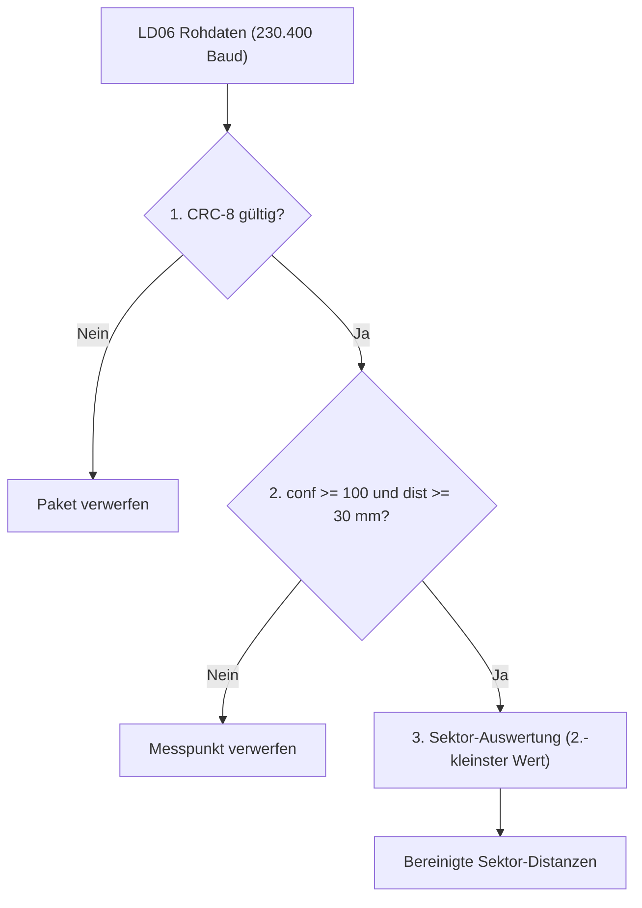

# Technische Hinweise zur TXT-4.0-Integration

Dieses Dokument beschreibt die wichtigsten technischen Erkenntnisse und Fehlerbehebungen rund um den Betrieb des **LD06 LiDAR-Sensors** am **fischertechnik TXT 4.0** (Firmware 5.0.1+, Linux 5.10, Python 3.12).

---

## 1. Systemumgebung des TXT 4.0

| Komponente | Details |
|---|---|
| **Controller** | fischertechnik TXT 4.0 |
| **Betriebssystem** | Yocto Linux (Kernel 5.10, ARM Cortex-A7) |
| **Python** | Python 3.12 |
| **Display** | Kapazitiver Touchscreen (physisch 240 × 320 Pixel) |
| **GUI-System** | `qtmenu` mit QtQuick 2.2 / QML |
| **GUI-Anbindung** | Lokaler Mosquitto MQTT-Broker (`127.0.0.1:2883`) über `ftgui.py` |
| **Sensor-Port** | `/dev/ttyUSB0` (230.400 Baud, Kernel-Modul `cp210x`) |

---

## 2. Nutzbarer Display-Bereich (240 × 230 Pixel)

Das physische Display besitzt im Hochformat **240 × 320 Pixel**. Da `qtmenu` jedoch Platz für Status- und Systemleisten reserviert, steht einer App (`TXTWindow` in QML) effektiv nur ein Bereich von **240 × 230 Pixeln** zur Verfügung (`x: 0..240`, `y: 0..230`).

Elemente mit `y >= 230` werden am unteren Rand abgeschnitten. Bewährt hat sich folgende Aufteilung:
* **y = 4..28:** Statuszeile (Höhe 24 px)
* **y = 32..172:** Radar-Canvas (140 × 140 px, zentriert bei `x = 50`)
* **y = 180..222:** Touch-Buttons (Höhe 42 px)

---

## 3. Behebung des Screen-Freezes in `ftgui.py`

### Symptom
Nach etwa 5–15 Sekunden fror die Anzeige auf dem TXT 4.0 ein, obwohl das Python-Skript im Hintergrund normal weiterlief.

### Ursache (MQTT Race Condition)
In `/usr/lib/python3.12/site-packages/ftgui.py` sendet `fttxt2_gui_connector` UI-Änderungen über den lokalen MQTT-Broker:

```python
def run_queue(self, forced=False):
    self.setter_lock.acquire()
    if bool(self.setter_queue):
        if self.setter_request == None or forced:
            q = self.setter_queue
            self.setter_queue = dict()
            self.setter_lock.release()
            # Publish erfolgt außerhalb des Locks:
            self.setter_request = self.client.publish(self.topic_notify, ..., qos=2)
            return
    self.setter_lock.release()

def on_publish(self, client, userdata, mid):
    if self.setter_request != None and mid == self.setter_request.mid:
        self.setter_request = None
    self.run_queue()
```

Über `127.0.0.1` antwortet Mosquitto oft schneller, als der Hauptthread die Zuweisung `self.setter_request = ...` abschließt:
1. Der MQTT-Hintergrundthread ruft `on_publish()` auf, solange `self.setter_request` noch `None` ist.
2. Kurz darauf setzt der Hauptthread `self.setter_request` auf das bereits bestätigte Nachrichtenobjekt.
3. Da kein weiteres `on_publish` für diese `mid` mehr folgt, bleibt `self.setter_request` dauerhaft gesetzt und blockiert alle weiteren UI-Updates.

### Lösung in `lib/display.py`
* **Locking:** `client.publish()` und die Zuweisung an `setter_request` laufen gemeinsam unter `setter_lock`.
* **Timeout-Watchdog:** Bleibt ein Request länger als 150 ms hängen oder ist `is_published()` bereits `True`, wird er automatisch freigegeben.
* **QoS 1 & Batch-Updates (`set_attrs`):** Mehrere UI-Attribute eines Frames werden in einer einzigen MQTT-Nachricht übertragen, was den Overhead deutlich senkt.

---

## 4. Filterung von Streulicht-Ausreißern beim LD06

### Symptom
Auch im Stillstand sprangen die Minimalwerte einzelner Sektoren gelegentlich von realen Abständen (z. B. 43 cm) kurzzeitig auf ca. 6 cm.

### Ursache
Eine Auswertung der Rohdaten zeigte zwei klar getrennte Punktgruppen:

| Kategorie | Typische Distanz | Signalstärke (`Confidence`) | Anteil |
|---|---|---|---|
| **Reale Objekte / Wände** | 40 cm – 300 cm | **126 – 244** (Ø ~238) | ~98,2 % |
| **Streulicht-Rauschen** | 6,2 cm – 10,1 cm | **22 – 25** | ~1,8 % |

An fernen Kanten oder bei flachen Einfallswinkeln entstehen schwache Reflexionen mit sehr kleiner Signalstärke (`conf < 30`), die der Sensor als kurzen Distanzwert ausgibt.

### Mehrstufiger Filter in `ld06.py` und `lidar_omni.py`



1. **CRC-8-Prüfsumme:** Jedes 47-Byte-Paket wird über eine Lookup-Tabelle (Polynom `0x4D`) geprüft.
2. **Confidence-Filter (`conf >= 100`):** Schwache Streulicht-Reflexionen werden ausgeblendet.
3. **Nahbereichs-Filter (`dist >= 30 mm`):** Unterdrückt Eigenreflexionen direkt am Sensorgehäuse.
4. **2-Punkte-Bestätigung (in den Sektor-Apps):** Pro 45°-Sektor wird der zweitkleinste Messwert herangezogen, sodass einzelne Ausreißer keine Fehlauslösung verursachen.

---

## 5. Omniwheel-Ausweichsteuerung

Aufbau, Motoranschlüsse (M1–M4) und Drehrichtungs-Matrix des 8-Wege-Ausweichalgorithmus sind in [`OMNIWHEEL_AVOIDANCE.md`](OMNIWHEEL_AVOIDANCE.md) dokumentiert.
